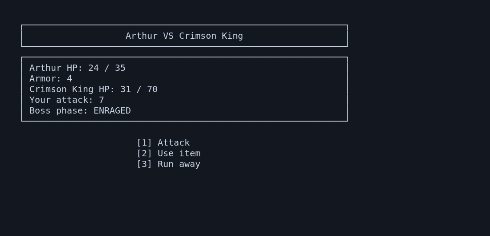

# ADVENTURE

A text-based RPG written in Python. Explore a castle, fight enemies, buy items and try to defeat the Crimson King.



## Gameplay

- Turn-based combat with armor, misses and temporary bonuses
- Random encounters, treasure, traps and shops
- Weapons, potions and an inventory
- Mini-bosses and a final boss with a second phase
- Save and load your progress in JSON

The game has 13 rooms. Mini-bosses appear in rooms 4 and 8, and the final boss is in room 13.

## Run

Requires Python 3.10+. There are no extra libraries needed to play.

```bash
python main.py
```

## Code

Game flow is in `core/`, character and item classes are in `models/`, and saving, input validation and terminal output are in `utils/`.

## Tests

Development tools can be installed with:

```bash
python -m pip install -e ".[dev]"
python -m pytest
```

The tests check combat, item effects, bosses, room progression and saving/loading. GitHub Actions runs them on Python 3.10–3.13.

## Author

Nazariy Martynyuk

